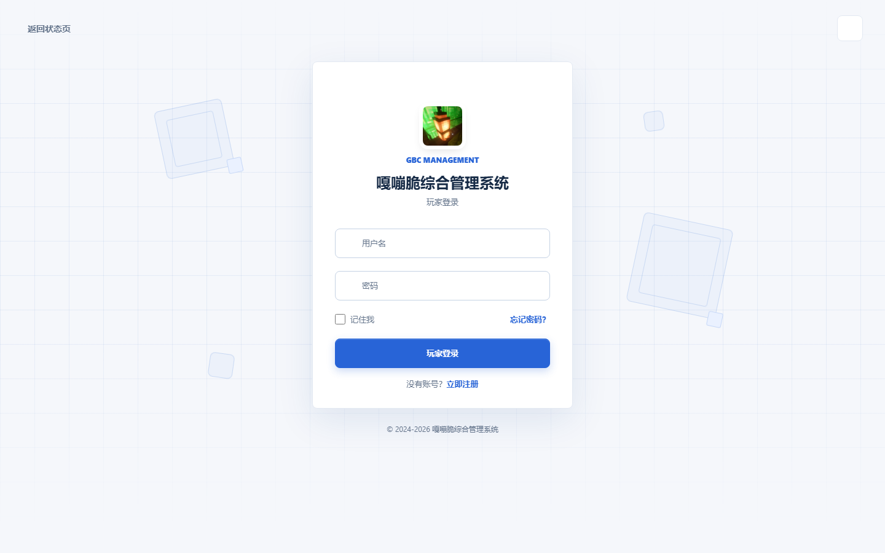

<div align="center">
  
  <h1>Gbcserver-Go</h1>
  <p>Web, administration, and plugin services for Minecraft Java servers.</p>
  <p>
    <a href="https://github.com/zhenxun321/gbcserver-go/stargazers"></a>
    <a href="https://github.com/zhenxun321/gbcserver-go/network/members"></a>
    <a href="https://github.com/zhenxun321/gbcserver-go/releases"></a>
    <a href="https://go.dev/"></a>
  </p>
  <p><a href="README.md">简体中文</a></p>
</div>

Gbcserver-Go provides player pages, an administration panel, a whitelist API, and a coupon redemption API for Minecraft Java servers. The server is written in Go. Separate Paper/Leaves plugins connect the whitelist and coupon features.



## What it does

- Player login, daily check-ins, shop, and server status pages
- Administrator accounts, site copy, runtime settings, and service status management
- Plugin token issuance, inspection, and revocation, plus whitelist and coupon listeners
- SQLite storage, configuration migrations, image management, and status probes
- Builds for nine Windows and Linux targets, with a shared project logo in Windows binaries

Windows binaries are signed with a self-signed code-signing certificate. Windows does not trust it by default and may show an unknown publisher or security warning.

## Quick start

### Requirements

| Dependency | Version |
| --- | --- |
| Go | 1.24 or later |
| JDK | 17 or later, for building plugins |
| Maven | 3.9 or later, for building plugins |
| Paper / Leaves | 1.21 series, for running plugins |

### Get the source

```bash
git clone https://github.com/zhenxun321/gbcserver-go.git
cd gbcserver-go
```

### Test and build

Run these commands from the repository root with PowerShell 7:

```powershell
Push-Location .\source
try {
    go test ./...
    go vet ./...
} finally {
    Pop-Location
}

.\source\build.ps1
# Local unsigned test package only; Windows release binaries require signing.
.\source\package.ps1 -SkipWindowsSignatureCheck
mvn -f .\plugins\whitelist\pom.xml clean package
mvn -f .\plugins\coupon\pom.xml clean package
```

The Go programs and deployment ZIP files are written to `目标文件/`. Plugin JAR files are written to `目标文件/plugins/whitelist/` and `目标文件/plugins/coupon/`; deploy them separately to the Paper/Leaves `plugins/` directory.

For a Windows release build, set `GBC_CODE_SIGN_CERT_THUMBPRINT` to the self-signed certificate thumbprint, then run `source/build.ps1` and `source/package.ps1 -AllowUntrustedWindowsSignature`.

### Start the server

Extract the ZIP for your platform and run the program from its directory:

```text
gbcserver-windows-amd64.exe start --tray
./gbcserver-linux-amd64 start --background
```

Open `http://server-address:port/admin/` on first use to set the administrator account, password, and TOTP. The default HTTP port is 80. If that port is restricted, run `gbcserver-<platform> httpport 8080` first. Pass `--data-dir <directory>` to both startup and configuration commands to use a custom data directory.

## Stack and structure

| Area | Implementation |
| --- | --- |
| Server | Go, SQLite, HTTP/HTTPS, and plugin listeners |
| Web pages | `source/web/`, embedded in the Go program at build time |
| Administration | Administrator sessions, runtime configuration, tokens, and service control |
| Game plugins | WhiteListSync and CouponPlugin for Paper/Leaves 1.21 |
| Windows icons | Multi-size ICO and Go Windows resources generated from `source/web/images/logo.png` |

Web source files are in `source/web/`; the build script syncs them to `source/cmd/gbcserver/web/`. Runtime data, databases, avatars, shop images, plugin JARs, and build outputs are not committed to Git.

## Documentation

| Topic | Document |
| --- | --- |
| Operation, configuration, upgrades, and migrations | [Deployment guide](source/deploy/部署说明.md) |
| Starting a release build | [Gbcserver-Go release guide](source/deploy/gbcserver-go发布说明.md) |
| HTTP/API integration | [API integration guide](source/deploy/API接口对接.md) |
| WhiteListSync | [Plugin guide](plugins/whitelist/插件说明.md) |
| CouponPlugin | [Plugin guide](plugins/coupon/插件说明.md) |
| OpenAPI | [openapi.yaml](openapi.yaml) |

## Repository layout

```text
source/                  Go server, web source, and build scripts
plugins/                 Paper/Leaves plugin source and documentation
source/deploy/           Deployment, startup, and API documentation
openapi.yaml             HTTP API definition
```

## Contributing

Before submitting changes, run the Go tests and `go vet`; rebuild plugins and release packages when needed. Report bugs and feature requests in [GitHub Issues](https://github.com/zhenxun321/gbcserver-go/issues). Submit code changes through a Pull Request.
