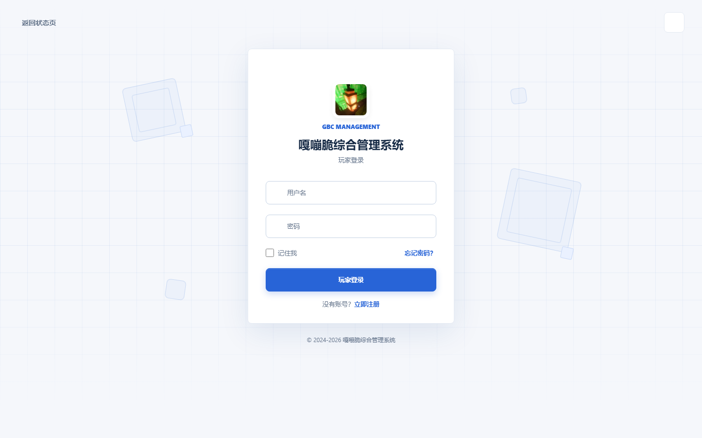

<div align="center">
  
  <h1>Gbcserver-Go</h1>
  <p>面向 Minecraft Java 服务器的网页、管理和插件服务。</p>
  <p>
    <a href="https://github.com/zhenxun321/gbcserver-go/stargazers"></a>
    <a href="https://github.com/zhenxun321/gbcserver-go/network/members"></a>
    <a href="https://github.com/zhenxun321/gbcserver-go/releases"></a>
    <a href="https://go.dev/"></a>
  </p>
  <p><a href="README.en.md">English</a></p>
</div>

Gbcserver-Go 为 Minecraft Java 服务器提供玩家网页、管理页面、白名单接口和兑换码接口。服务端使用 Go；白名单与兑换功能由独立的 Paper/Leaves 插件连接。



## 能做什么

- 玩家登录、签到、商城和服务器状态页
- 管理员账户、站点文案、运行参数和服务状态管理
- 插件令牌签发、查看、撤销，以及白名单和兑换 listener
- SQLite 数据存储、配置迁移、图片管理和状态探测
- Windows、Linux 九个平台构建，Windows 程序使用项目统一 logo

Windows 程序使用自签名代码签名证书。Windows 默认不信任该证书，可能显示未知发布者或安全警告。

Windows binaries are signed with a self-signed code-signing certificate. Windows does not trust it by default and may show an unknown publisher or security warning.

## 快速开始

### 环境要求

| 依赖 | 版本 |
| --- | --- |
| Go | 1.24 或更高版本 |
| JDK | 17 或更高版本，用于构建插件 |
| Maven | 3.9 或更高版本，用于构建插件 |
| Paper / Leaves | 1.21 系列，用于运行插件 |

### 获取源码

```bash
git clone https://github.com/zhenxun321/gbcserver-go.git
cd gbcserver-go
```

### 检查和构建

在仓库根目录使用 PowerShell 7：

```powershell
Push-Location .\source
try {
    go test ./...
    go vet ./...
} finally {
    Pop-Location
}

.\source\build.ps1
# 本地未签名测试包；正式 Windows 发布需要签名文件
# Local unsigned test package only; Windows release binaries require signing.
.\source\package.ps1 -SkipWindowsSignatureCheck
mvn -f .\plugins\whitelist\pom.xml clean package
mvn -f .\plugins\coupon\pom.xml clean package
```

Go 程序和部署 ZIP 输出到 `目标文件/`。插件 JAR 分别输出到 `目标文件/plugins/whitelist/` 和 `目标文件/plugins/coupon/`，单独部署到 Paper/Leaves 的 `plugins/` 目录。

正式构建 Windows 发布包时，将自签名证书指纹配置到 `GBC_CODE_SIGN_CERT_THUMBPRINT`，再运行 `source/build.ps1` 和 `source/package.ps1 -AllowUntrustedWindowsSignature`。

### 启动服务

解压对应平台 ZIP，在程序所在目录运行：

```text
gbcserver-windows-amd64.exe start --tray
./gbcserver-linux-amd64 start --background
```

首次访问 `http://服务器地址:端口/admin/`，设置管理员账户、密码和 TOTP。默认 HTTP 端口为 80；端口受限时，先运行 `gbcserver-<平台> httpport 8080`。自定义数据目录时，为启动和设置命令都传入 `--data-dir <目录>`。

## 技术栈与结构

| 部分 | 实现 |
| --- | --- |
| 服务端 | Go、SQLite、HTTP/HTTPS 和插件 listener |
| 网页 | `source/web/`，构建时嵌入 Go 程序 |
| 管理功能 | 管理员 session、运行配置、令牌和服务控制 |
| 游戏插件 | Paper/Leaves 1.21 的 WhiteListSync、CouponPlugin |
| Windows 图标 | `source/web/images/logo.png` 生成的多尺寸 ICO 和 Go Windows 资源 |

网页源文件位于 `source/web/`，构建脚本会同步到 `source/cmd/gbcserver/web/`。运行数据、数据库、头像、商品图片、插件 JAR 和构建产物不提交到 Git。

## 文档

| 内容 | 文档 |
| --- | --- |
| 运行、配置、升级和迁移 | [部署说明](source/deploy/部署说明.md) |
| 正式版启动 | [Gbcserver-Go 发布说明](source/deploy/gbcserver-go发布说明.md) |
| HTTP/API 对接 | [API 接口对接说明](source/deploy/API接口对接.md) |
| WhiteListSync | [插件说明](plugins/whitelist/插件说明.md) |
| CouponPlugin | [插件说明](plugins/coupon/插件说明.md) |
| OpenAPI | [openapi.yaml](openapi.yaml) |

## 项目结构

```text
source/                  Go 服务端、网页源文件和构建脚本
plugins/                 Paper/Leaves 插件源码与说明
source/deploy/           部署、启动和 API 文档
openapi.yaml             HTTP API 定义
```

## 参与开发

提交修改前请运行 Go 测试、`go vet`，并在需要时重新构建插件和发布包。问题反馈和功能建议请提交到 [GitHub Issues](https://github.com/zhenxun321/gbcserver-go/issues)；代码修改请通过 Pull Request 提交。
